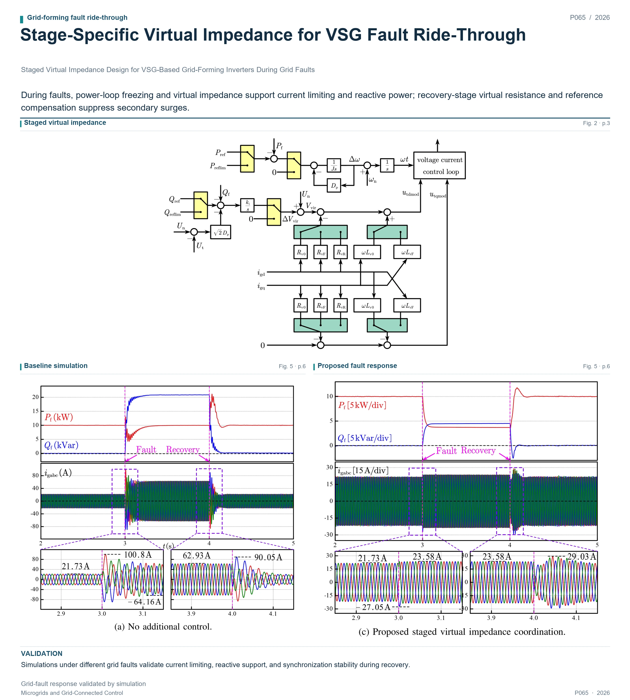

## Abstract

Grid-forming inverters (GFMs) with virtual synchronous generator (VSG) control can provide inertial and voltage support for low-inertia power systems. However, under severe grid faults, their voltage-source behavior may lead to excessive fault current, insufficient reactive current support, and secondary current transients after fault clearance. This paper proposes a staged virtual impedance coordination strategy for VSG-controlled GFMs to improve fault ride-through and post-fault recovery performance. In the fault-on stage, the power control loops are frozen to prevent power-angle divergence, and a feasible virtual impedance region is established by jointly considering steady-state fault-current limitation, transient inrush-current suppression, and reactive current support. In the post-fault recovery stage, a recovery-oriented virtual resistance with power-reference compensation is introduced to suppress secondary current transients and smoothly restore normal VSG operation. Simulation results under different fault conditions verify that the proposed strategy can limit fault current, maintain reactive support, reduce recovery transients, and preserve synchronization stability.

<figure id="research-figure" class="publication-figure">
  
</figure>
