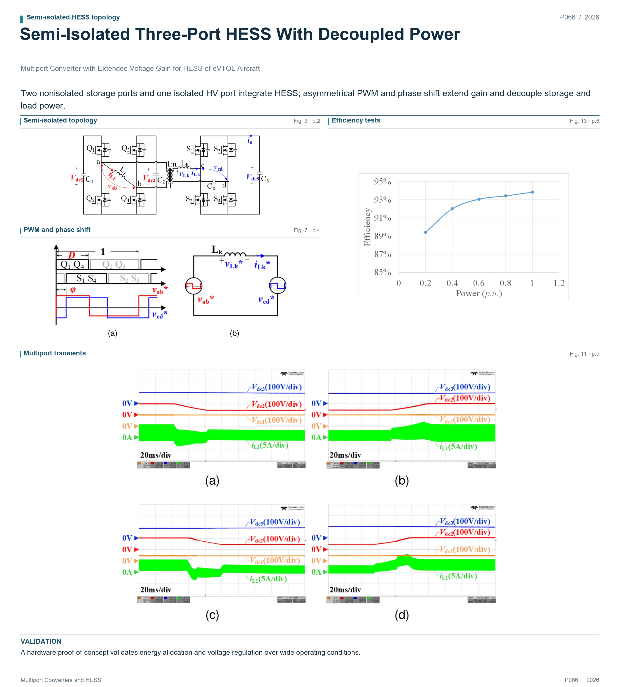

## Abstract

The rapid electrification of transportation, including EVs, more-electric aircraft, and eVTOL platforms, demands onboard power systems capable of handling wide-ranging energy and power requirements. Hybrid energy storage systems (HESS), combining high-energy and high-power devices, offer a promising solution. However, their effective integration requires power converters with wide voltage adaptability, flexible multi-port power management, and stable DC bus regulation. This paper proposes a semi-isolated three-port DC–DC converter to address these challenges. The converter integrates two non-isolated HESS ports and one isolated high-voltage port, enabling active HESS control with reduced complexity compared to conventional multi-converter and multi-active-bridge solutions. By employing coordinated modulation, the proposed converter achieves extended voltage gain range and decoupled control of HESS power flow and load power delivery. Analytical results and hardware experiments validate its effectiveness under wide operating conditions, demonstrating its suitability for eVTOL and other electrified transportation applications.

<figure id="research-figure" class="publication-figure">
  
</figure>
