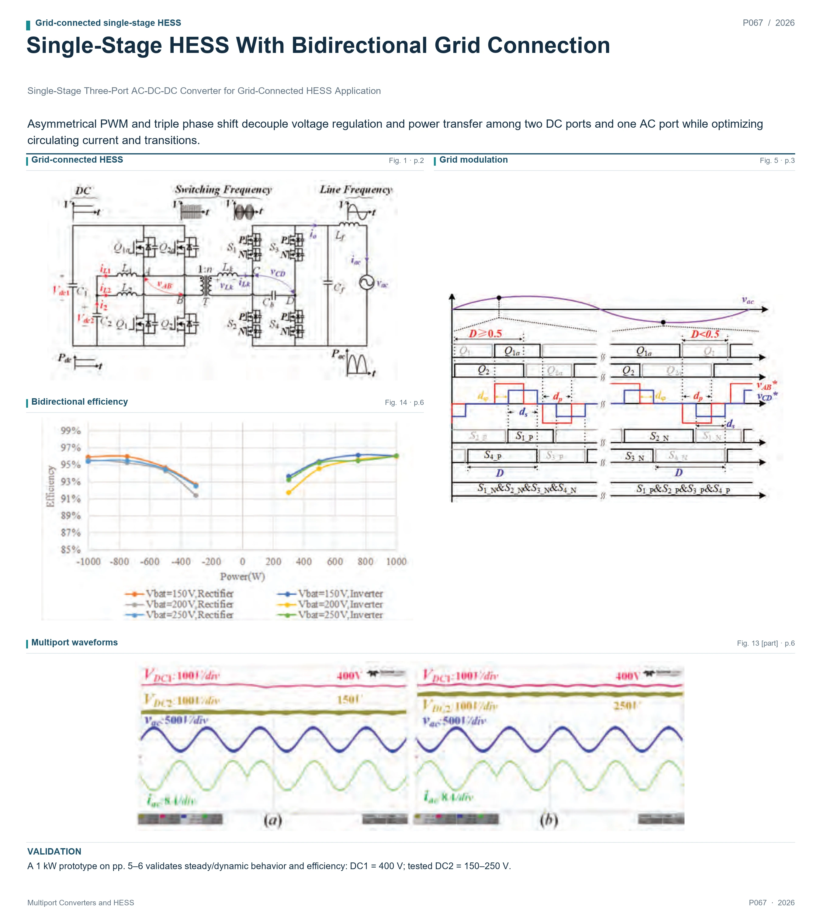

## Abstract

Hybrid energy storage systems require compact and efficient power interfaces capable of coordinating multiple energy sources while maintaining grid compatibility. This paper proposes an isolated single-stage converter featuring two DC terminals and one AC terminal for such applications. A coordinated modulation approach based on asymmetric pulse-width modulation and triple-phase-shift control is developed to decouple voltage regulation from power-transfer management. The proposed scheme supports bidirectional energy exchange, grid-current conditioning, and flexible operating-point control without introducing additional conversion stages. Furthermore, the modulation variables are optimized to suppress undesired circulating current and ensure smooth transitions among different operating regions. The performance of the proposed converter is assessed through simulation results, demonstrating its suitability for grid-interfaced hybrid energy storage systems.

<figure id="research-figure" class="publication-figure">
  
</figure>
