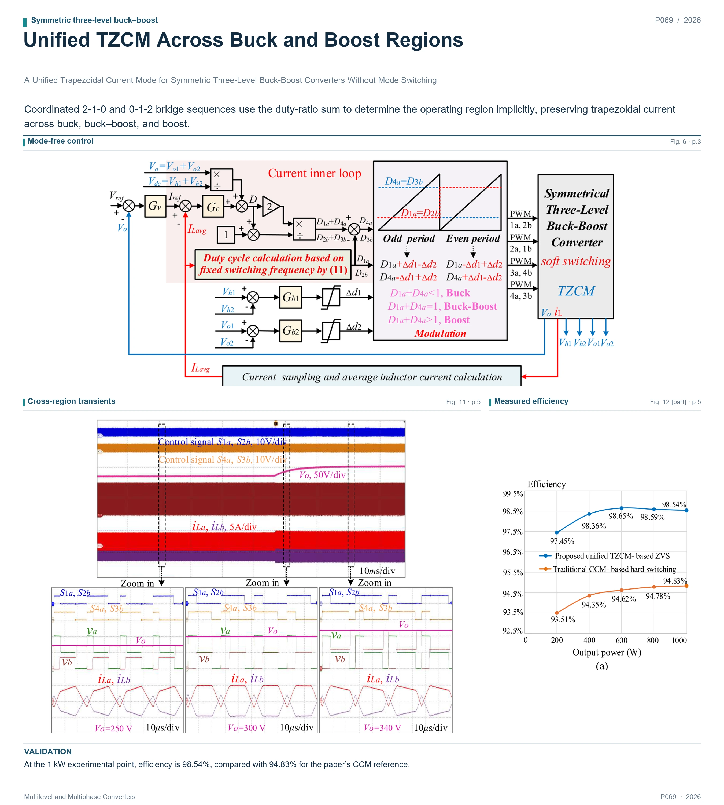

## Abstract

Owing to its advantages of low voltage stress and a wide voltage conversion range, the symmetric three-level Buck-Boost converter has attracted considerable interest. However, significant switching losses under conventional hard-switching operation limit its power density and efficiency. To address this issue, this paper proposes a unified trapezoidal current mode (TZCM) modulation scheme that enables zero-voltage switching (ZVS) operation in Buck, Buck-Boost, and Boost modes without explicit mode switching. The trapezoidal current waveform is formed by coordinating the 2-1-0 level sequence of the left bridge with the 0-1-2 level sequence of the right bridge. Based on the analytical relationship between the duty cycles and the output voltage, the operating mode is implicitly defined by the sum of duty cycles, allowing smooth transition among different voltage conversion regions. The proposed method not only achieves ZVS, but also eliminates the need for mode switching across the entire voltage conversion range. Finally, experimental results of the symmetric three-level Buck-Boost converter validate the effectiveness and feasibility of the proposed TZCM modulation method, achieving an efficiency of 98.54% at 1 kW, compared with 94.83% under continuous conduction mode (CCM) operation.

<figure id="research-figure" class="publication-figure">
  
</figure>
