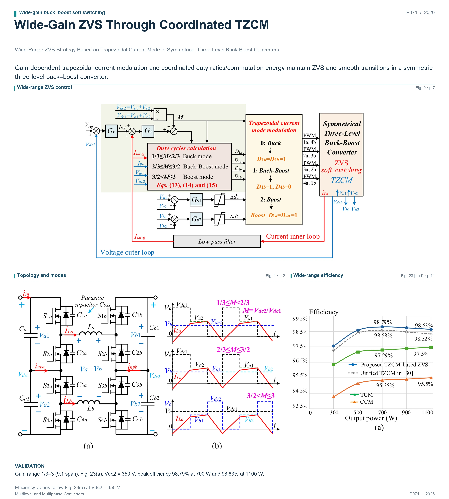

## Abstract

Symmetric three-level Buck-Boost converters typically operate in continuous conduction mode (CCM), resulting in hard-switching operation, while existing soft-switching techniques are limited by either a narrow output-voltage regulation range or excessive inductor peak currents. To address these issues, this paper proposes a wide-range zero-voltage switching (ZVS) strategy based on trapezoidal current mode (TZCM). Specifically, distinct modulation schemes are developed for different output-to-input voltage ratios to maintain the trapezoidal current waveform through appropriate reconfiguration of the converter operating states. The duty cycles for each operating mode are analytically derived and coordinated to shape the trapezoidal inductor current. Furthermore, a wide-range ZVS control method is established to accommodate a wide voltage operating range. Consequently, extended-range ZVS operation is achieved without additional auxiliary circuits or current overshoot while preserving the desired trapezoidal current characteristics. The feasibility and effectiveness of the proposed modulation schemes and control method are experimentally validated using a hardware prototype, demonstrating ZVS operation over a voltage gain range from 1/3 to 3 and a peak efficiency of 98.63% at 700 W.

<figure id="research-figure" class="publication-figure">
  
</figure>
