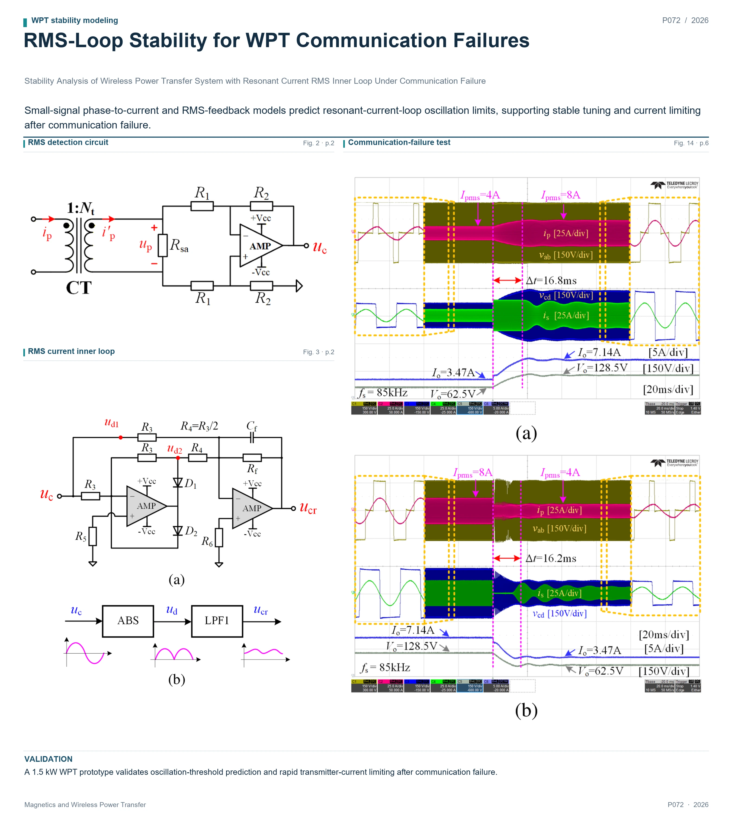

## Abstract

In wireless power transfer (WPT) systems, incorporating a resonant current RMS inner loop into a single voltage/current closed loop is a vital method to effectively mitigate the risk of sudden current surges at the transmitting (Tx) coil caused by communication failure, significantly enhancing the system safety. However, the stability of the resonant current RMS inner loop and the influence of its controller parameters on system stability remain unclear. To address this critical issue, this paper first derives the small-signal transfer function from the phase-shift duty cycle to the Tx-side resonant current peak value. Then, the small-signal transfer function of the resonant current RMS detection feedback loop is derived and established for the first time. Subsequently, a complete small-signal closed-loop control block diagram of the resonant current RMS inner loop is also proposed. Benefiting from this block diagram, the controller parameters at which the closed-loop system reaches critical oscillation can be accurately predicted. A 1.5-kW WPT system is designed and optimized to verify the effectiveness of the modeling method.

<figure id="research-figure" class="publication-figure">
  
</figure>
