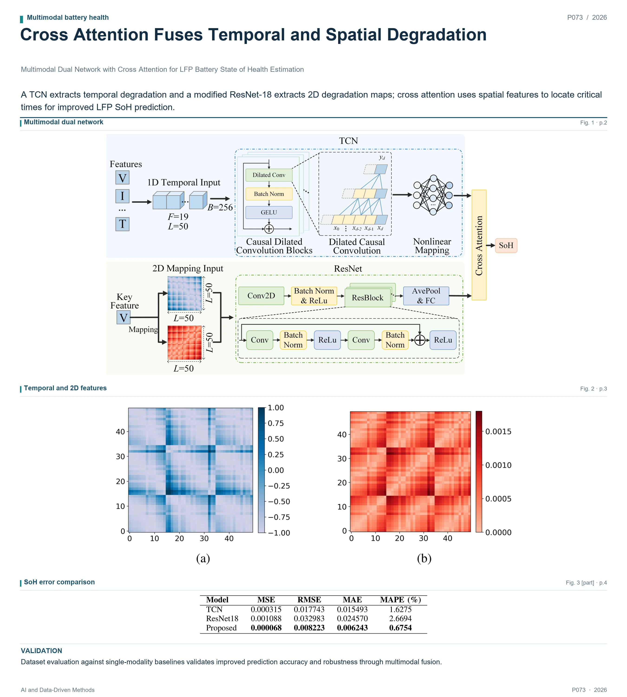

## Abstract

Accurate state of health (SoH) estimation for lithium iron phosphate (LFP) batteries is vital for ensuring the safety and economic efficiency of battery management systems. However, conventional data-driven methods, which rely primarily on single-modality features, struggle to fully capture the complex degradation trajectories characterized by strong temporal dependency, nonlinearity, and stage-wise characteristics, especially given the uniquely flat voltage plateau of LFP batteries. To address this issue, this paper proposes a multimodal dual-network cross-attention framework that fuses one-dimensional temporal dynamics with two-dimensional structural degradation maps. In the proposed method, a temporal convolutional network branch extracts the chronological evolution of degradation from temporal windows, while a modified 18-layer residual network branch captures global spatial morphology and local recurrent patterns from degradation maps. Furthermore, a cross-attention fusion mechanism enables adaptive interaction, allowing macroscopic spatial features to guide the model in dynamically pinpointing critical degradation nodes within the temporal sequence. Experimental results demonstrate that the proposed dual-network multimodal framework significantly outperforms single-modality baselines, achieving higher predictive accuracy and robustness.

<figure id="research-figure" class="publication-figure">
  
</figure>
