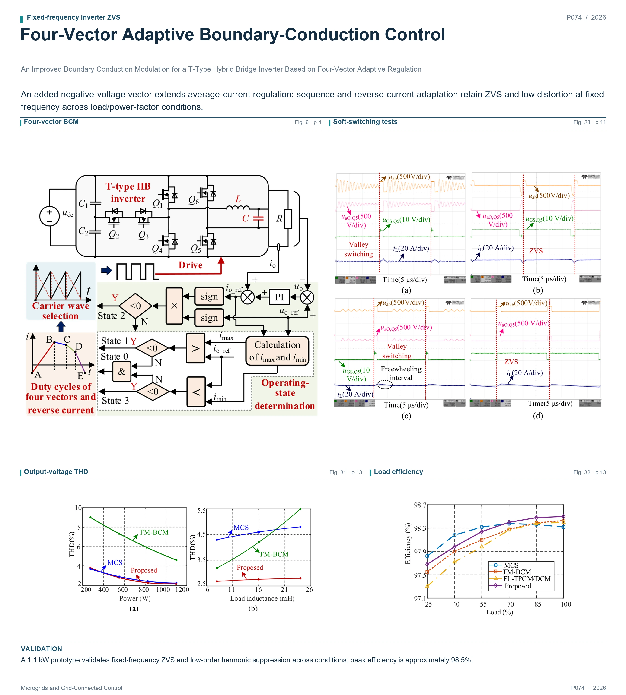

## Abstract

Boundary conduction mode (BCM) is widely adopted in high-efficiency inverters due to the soft-switching characteristics. However, the variable modulation frequency of conventional BCM spreads the inductor-current ripple over a wide frequency range, significantly complicating the output-filter design. To address the above issue, an improved BCM strategy for a T-type hybrid bridge inverter based on four-vector adaptive regulation is proposed. By analyzing the upper and lower bounds of the average inductor current under fixed-frequency modulation, the limitation of inductor current regulation for the conventional trapezoidal BCM is revealed. Based on the derived boundaries, an additional negative voltage vector is introduced as an intra-period charge-regulation degree of freedom, and the vector dwell times are adaptively allocated to extend the achievable average-current range. Furthermore, under non-unity-power-factor and non-rated-load conditions, the switching sequence is reconstructed and the reverse-current amplitude is adaptively regulated according to the current boundaries, thereby suppressing output-voltage harmonics while maintaining zero-voltage switching (ZVS) under fixed-frequency modulation. Finally, the effectiveness of the proposed method is validated on a 1.1-kW experimental prototype, achieving a peak efficiency of approximately 98.5%.

<figure id="research-figure" class="publication-figure">
  
</figure>
