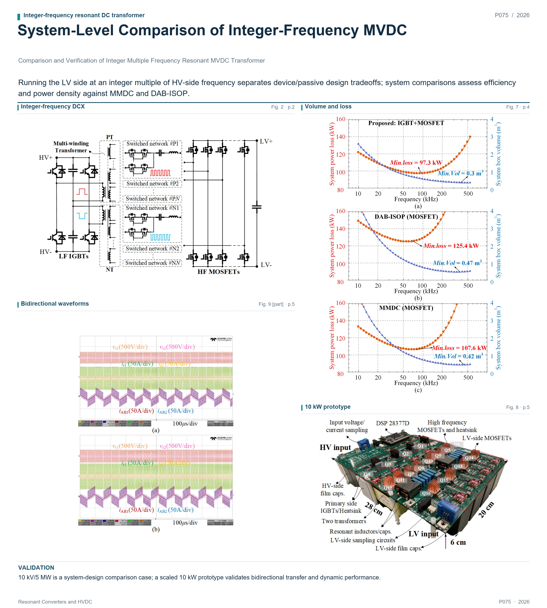

## Abstract

In medium- and high-voltage DC systems, high-voltage devices suffer from substantial switching losses, which constrain switching frequency and increase converter size. This article proposes an integer multiple frequency resonant (IMFR) MVDC transformer, in which the low-voltage side operates at an integer multiple of the high-voltage-side switching frequency. This architecture significantly reduces HV-side switching losses while enabling high-frequency operation on the LV side, thereby improving power density. A case study of a 10 kV/5 MW MVDC system is presented to establish system-level design guidelines and evaluate performance. Compared with modular multilevel DC–DC (MMDC) and input-series output-parallel (ISOP) converters, the proposed topology achieves higher efficiency and power density. A down-scaled 10 kW prototype further validates bidirectional operation, high efficiency, high power density, and stable performance under dynamic load conditions.

<figure id="research-figure" class="publication-figure">
  
</figure>
