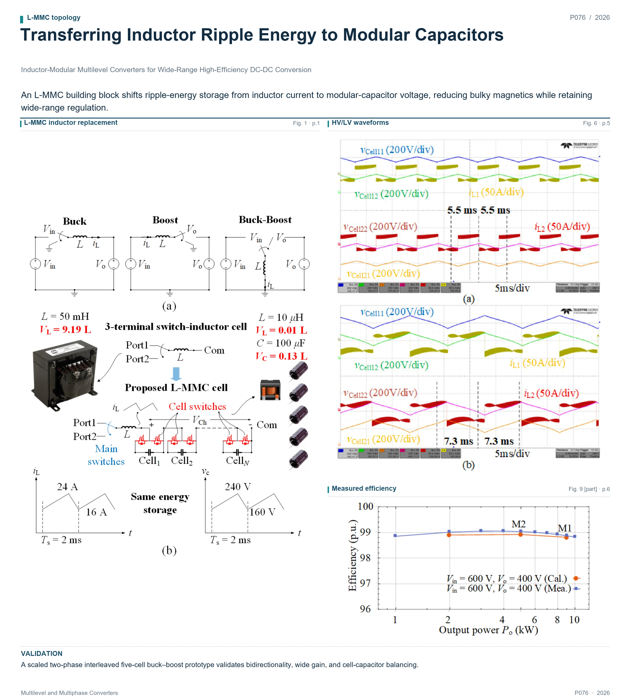

## Abstract

Achieving both high efficiency and high power density ischallenging in DC–DC converters with large step-up/down ratios or wide voltage regulation ranges. This article proposes the inductor-modular multilevel converter (L-MMC) as a fundamental building block for DC–DC power conversion. By transferring conventional inductor current ripple into voltage ripple across MMC cells, bulky inductors are replaced with high-energy-density capacitors, substantially improving power density while preserving the original converter structure and wide regulation capability. The resulting quasi-square inductor current enables high efficiency even under extreme step-up/down conditions. A down-scaled, two-phase interleaved, five-cell buck–boost L-MMC prototype experimentally validates the proposed concept, demonstrating bidirectional power flow, high voltage conversion ratio, high power density, high efficiency, and effective MMC cell voltage balancing.

<figure id="research-figure" class="publication-figure">
  
</figure>
