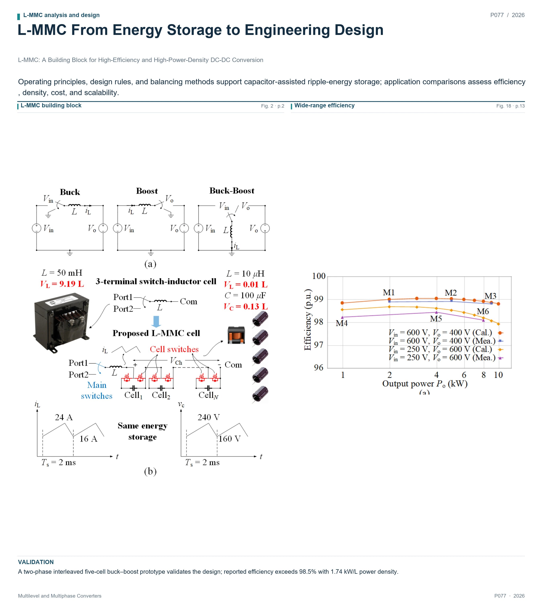

## Abstract

Achieving high efficiency and high power density simultaneously remains a key challenge in dc–dc conversion, particularly for applications requiring high step-up/down ratios and wide voltage regulation ranges. This article proposes the inductor-modular multilevel converter (L-MMC) as a fundamental building block for dc–dc power conversion. By transferring the ripple energy storage requirement from inductors to modular cell capacitors, the proposed topology reduces dependence on bulky magnetic components and exploits the higher energy density of capacitive storage, while preserving wide voltage regulation capability. The operating principles, design criteria, and cell-voltage balancing strategies are established. Two application-oriented case studies are presented to demonstrate topology selection, parameter design, and system-level tradeoffs in cost, scalability, and practicality. To validate the concept, a down-scaled two-phase interleaved five-cell buck–boost prototype is developed. Experimental results verify bidirectional operation, wide-range voltage conversion, effective cell-voltage balancing, and an efficiency above 98.5% with a power density of 1.74 kW/L. These results indicate that the proposed L-MMC provides a favorable overall tradeoff among efficiency, power density, voltage regulation range, and modular scalability for wide-range dc–dc applications.

<figure id="research-figure" class="publication-figure">
  
</figure>
