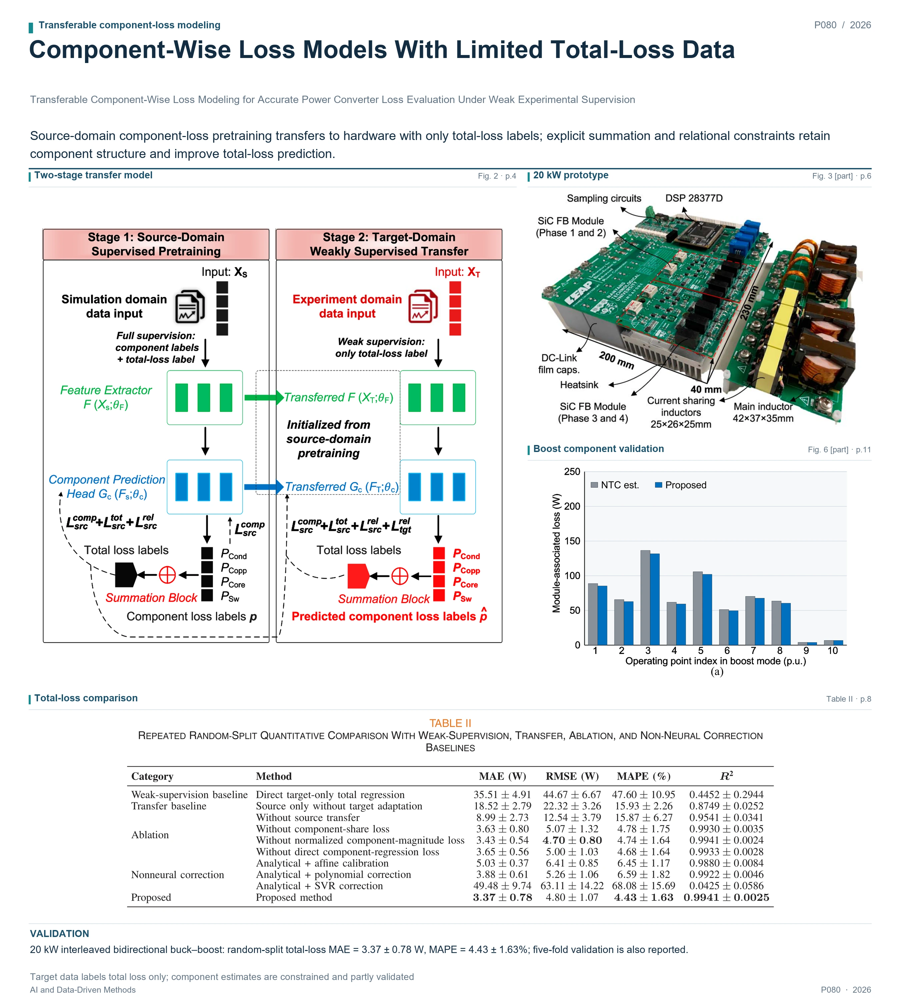

## Abstract

Accurate power-loss evaluation is critical to power converter design, yet remains challenging because simulation-based analysis often deviates from practical hardware, whereas experimental characterization is costly and typically provides only total-loss measurements. To address this issue, this article proposes a transferable component-wise loss modeling framework for accurate converter loss evaluation under weak experimental supervision. Instead of directly regressing total loss as a single scalar, the proposed method predicts grouped loss components and reconstructs total loss through an explicit summation constraint, thereby improving target-domain prediction accuracy while retaining a physically constrained component-wise structure. The proposed method is validated on a 20-kW interleaved bidirectional buck–boost DC–DC converter. A fully labeled source-domain dataset is constructed through analytical loss calculation over a wide operating range, while a limited target-domain dataset is obtained from prototype measurements. Under repeated random-split evaluation, the proposed method achieves a mean absolute error (MAE) of 3.37 ± 0.78 W, a root mean square error (RMSE) of 4.80 ± 1.07 W, a mean absolute percentage error (MAPE) of 4.43 ± 1.63%, and an R² of 0.9941 ± 0.0025. Compared with direct target-only regression, it reduces the average MAE, RMSE, and MAPE by 90.51%, 89.27%, and 90.70%, respectively. Five-fold cross-validation further gives an MAE of 4.16 ± 1.44 W, an RMSE of 5.43 ± 1.90 W, a MAPE of 5.97 ± 3.38%, and an R² of 0.9925 ± 0.0041.

<figure id="research-figure" class="publication-figure">
  
</figure>
