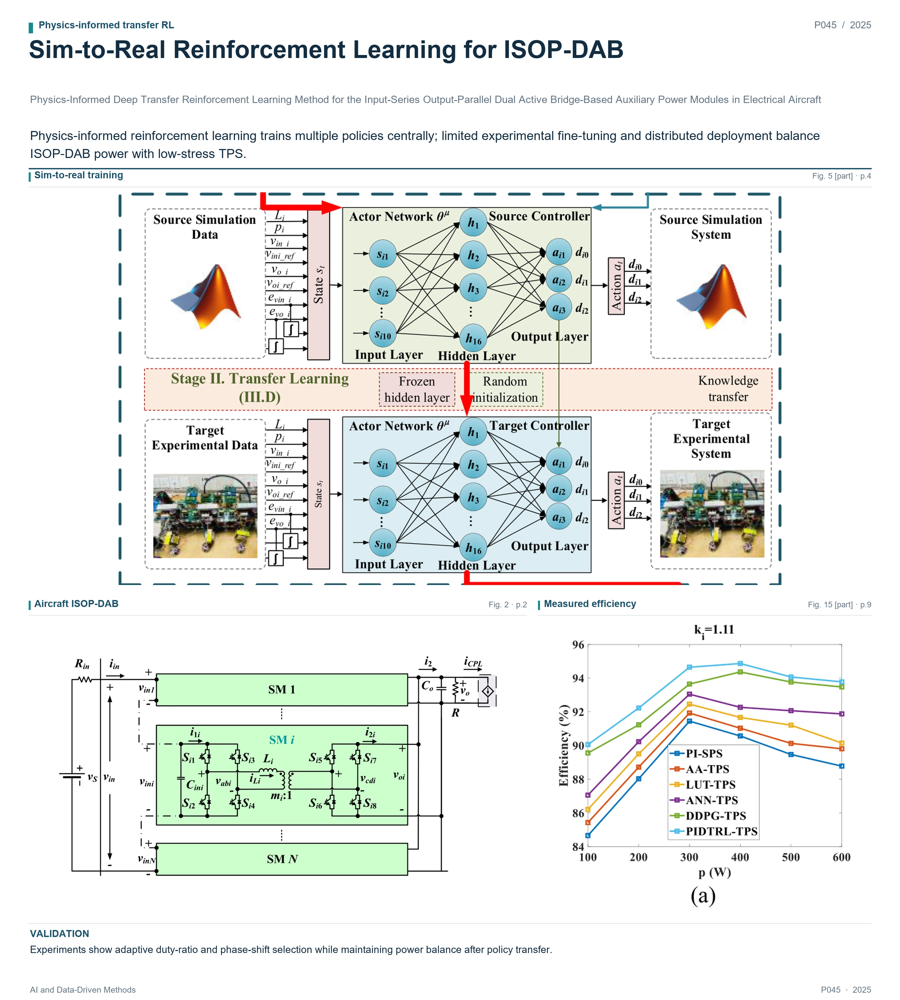

## Abstract

This article proposes a physics-informed deep transfer reinforcement learning (PIDTRL) approach for power balance control and triple phase shift (TPS) modulation method for the input-series output-parallel dual active bridge (ISOP-DAB) converter-based auxiliary power module (APM) in electric aircraft. The approach involves three stages: 1) centralized training of deep reinforcement learning agents to balance power and reduce current stress in the ISOP-DAB converter; 2) effective knowledge transfer from a source simulation system to a target experimental system using minimal experimental data, providing a scalable solution without extensive data reliance; and 3) deployment of multiple agents for online control in the ISOP-DAB converter. The proposed method adaptively determines optimal modulation variables (duty cycles and phase shifts) in stochastic and uncertain environments without requiring accurate model information. The experimental results validate the effectiveness of the proposed PIDTRL algorithm.

<figure id="research-figure" class="publication-figure">
  
</figure>
