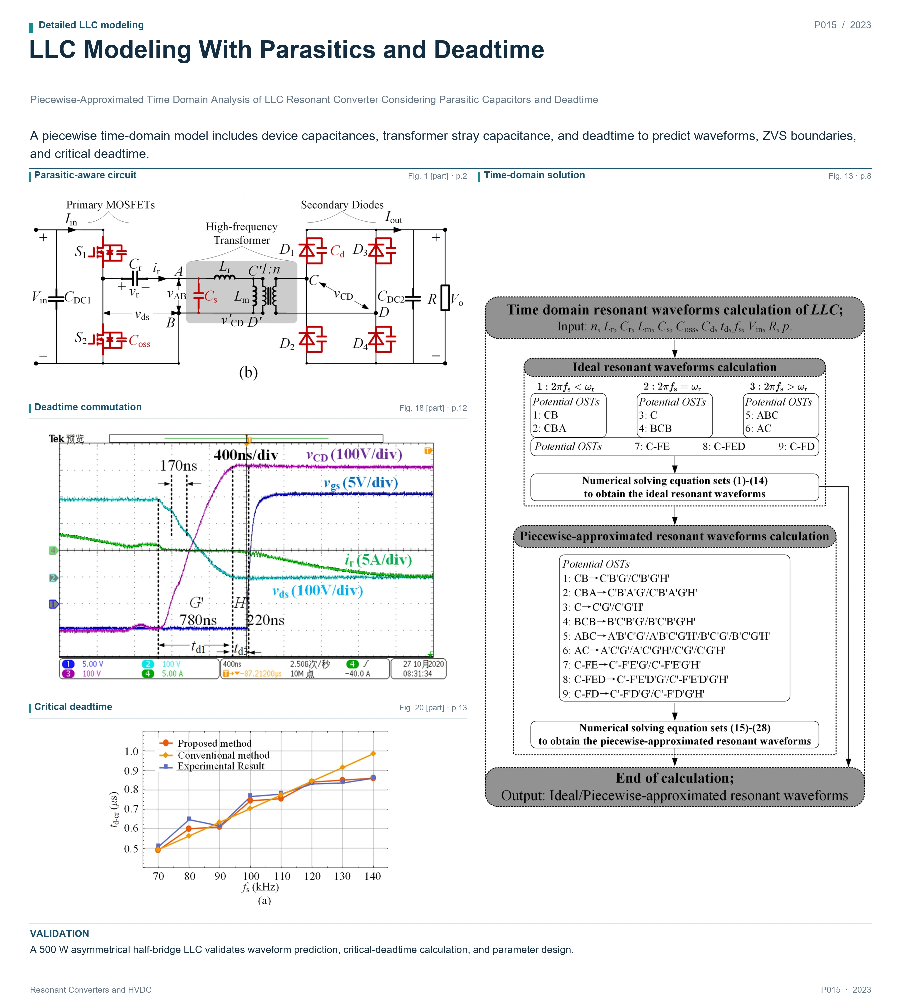

## Abstract

LLC resonant converters are widely used in high power density and high efficiency applications. Practically, the parasitic capacitors of mosfets and diodes, the stray capacitor of the high frequency transformer, and the dead time will have a great impact not only on the steady state resonant waveforms but also on the zero voltage switching-on (ZVS-on) of the mosfets. This article presents a piecewise-approximated time domain analysis of LLC both considering the parasitic/stray capacitors and the dead time. On this basis, not only the accurate steady state resonant waveforms, but also the ZVS-on boundary can be obtained, which will guide the parameter design, and switching frequency/dead time configuration instead of slow and cumbersome simulations. The major applications of the presented analysis, including the resonant/switching waveform illustration, the critical dead time calculation, and the optimal converter design are verified by a 500 W asymmetric half bridge LLC experimental prototype.

<figure id="research-figure" class="publication-figure">
  
</figure>
