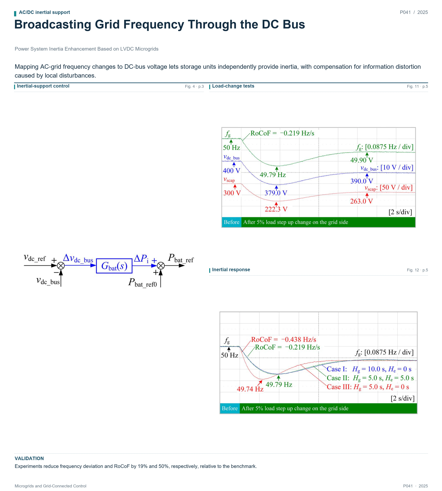

## Abstract

There is a critical need to increase power system inertia during the grid transformation. However, in a low-voltage dc (LVDC) microgrid, many potential inertia contributors, such as energy storage systems, are linked to the local dc bus and managed by their individual distributed controllers. This configuration results in a lack of access to grid frequency information, limiting their ability to emulate inertia. To address this challenge without relying on real-time communications, this article proposes a power system inertia enhancement scheme based on LVDC microgrids. This scheme ensures that all potential units within the LVDC microgrids can be mobilized and independently configured to enhance the power system inertia. Furthermore, it also accounts for and compensates for various disturbances encountered within LVDC microgrids, like load switching. Experimental verifications are provided, demonstrating the effectiveness of the proposed method.

<figure id="research-figure" class="publication-figure">
  
</figure>
