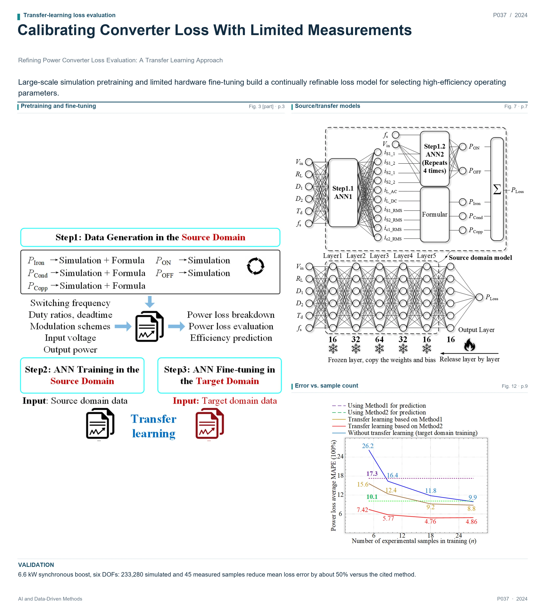

## Abstract

A precise evaluation of power converter losses is essential for accurately predicting power loss and optimizing control parameters to enhance efficiency across various scenarios and applications. Conventional power loss evaluation methods separate the theoretical analysis and experimental verification stages. Consequently, these methods often suffer from irreconcilable disparities between the analytical predictions and measurement outcomes. This article introduces a transfer learning (TL)-based refinement approach for power loss evaluation, which can be iteratively improved with ongoing experimental data. Our method entails the creation of an extensive source domain dataset for training a source domain model, followed by fine-tuning in the target domain. Consequently, a self-adaptive and refined power loss evaluation model is established with a small amount of experimental data. We conducted a case study featuring a 6.6 kW synchronous boost converter, considering six degrees of freedom for operational conditions. Leveraging a dataset of 2 33 280 simulation samples and 45 experimental samples, our refined power loss evaluation model achieved a remarkable 50% reduction in average power loss error compared with conventional methodologies. Guided by the TL refined power loss model, the peak efficiency and corresponding optimal control parameters can be obtained.

<figure id="research-figure" class="publication-figure">
  
</figure>
