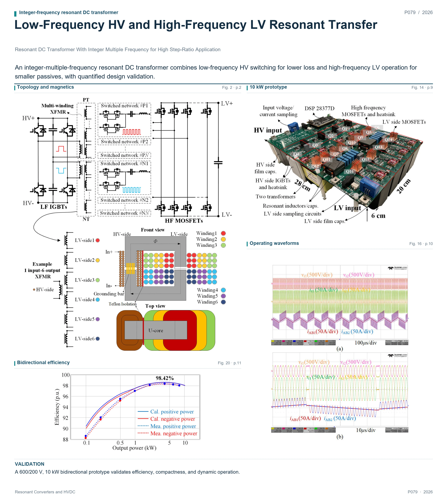

## Abstract

In medium- and high-voltage (MV/HV) DC systems, switching losses in HV power switches constrain system switching frequency and increase system volume. This paper proposes an integer multiple frequency resonant (IMFR) DC transformer topology, where the low-voltage (LV) side operates at a switching frequency that is an integer multiple of the HV side. This configuration reduces HV-side switching losses while enabling high-frequency operation on the LV side, leading to reduced passive component volume. A 10 kW bidirectional prototype is developed for quantitative analysis and design guidance. Compared to conventional identical-frequency solutions, the proposed topology achieves higher efficiency and power density. Experimental results confirm its bidirectional operation, high efficiency, compactness, and robust performance under dynamic load conditions.

<figure id="research-figure" class="publication-figure">
  
</figure>
