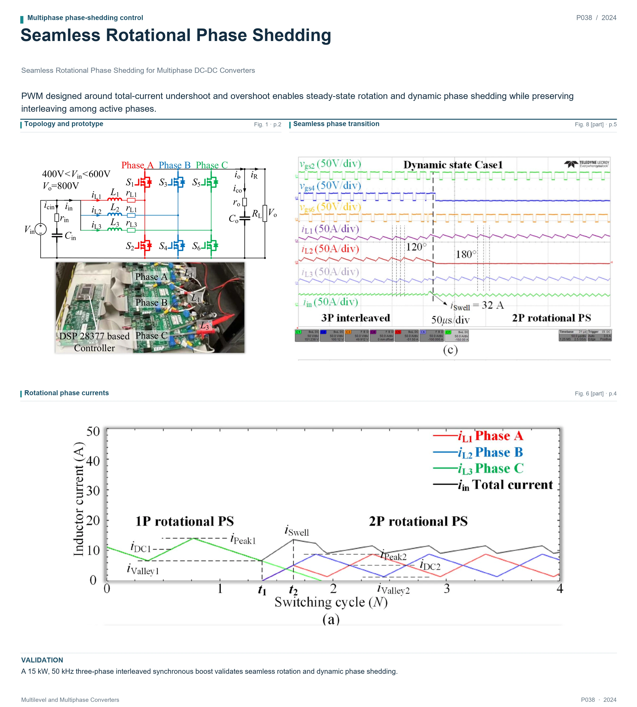

## Abstract

This letter proposes a seamless rotational phase shedding (PS) operating method designed for multiphase dc–dc converters. Utilizing a 15 kW/50 kHz three-phase interleaved synchronous boost converter as an example, the optimal activation of phases is determined by minimizing power losses. Through a comprehensive analysis of total inductor current sag and swell in both steady-state and dynamic rotational PS operation, the optimal pulsewidth modulation switching patterns are identified. Experimental results demonstrate that the proposed method outperforms traditional approaches, seamlessly achieving rotational PS while preserving interleaved among different activated phases.

<figure id="research-figure" class="publication-figure">
  
</figure>
