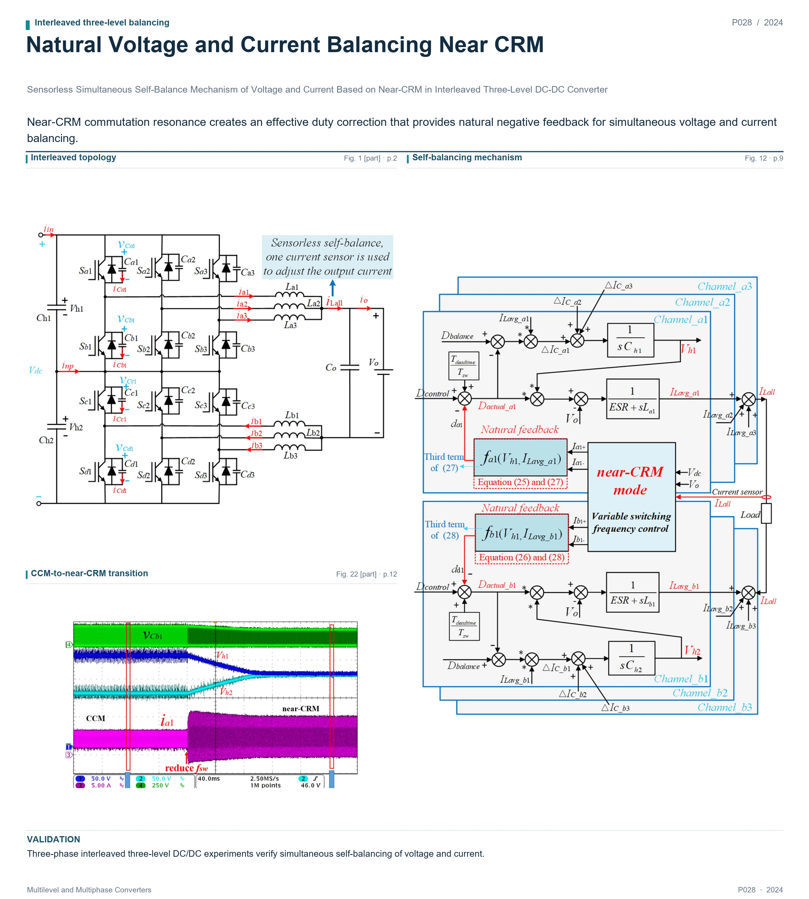

## Abstract

Voltage and current balance are essential in an interleaved three-level dc–dc converter. In this article, a simultaneous voltage and current self-balance mechanism based on near-critical conduction mode (CRM) for an interleaved three-level dc–dc converter is discovered, which can realize current and voltage balancing automatically without sensors. First, the zero-voltage switching (ZVS) and resonance transition generated by near-CRM are analyzed in detail. Second, the actual equivalent duty cycle is formulated to disclose its relationship to the unbalanced capacitor voltages and unbalanced inductor currents. It is found that the additional equivalent duty cycles in near-CRM are created and affected by the resonance around the valley and peak currents, so that some feedback loops are naturally formed to adjust the unbalanced voltages and currents. Then, by constructing the 3D relationship and natural feedback loops, the simultaneous voltage and current self-balance mechanism is proposed, where the additional equivalent duty cycles are simultaneously compensated by the unbalanced voltages and currents to counteract the unbalanced components. Finally, a three-phase interleaved three-level dc–dc converter is tested to experimentally verify the voltage and current self-balance mechanism based on near-CRM.

<figure id="research-figure" class="publication-figure">
  
</figure>
