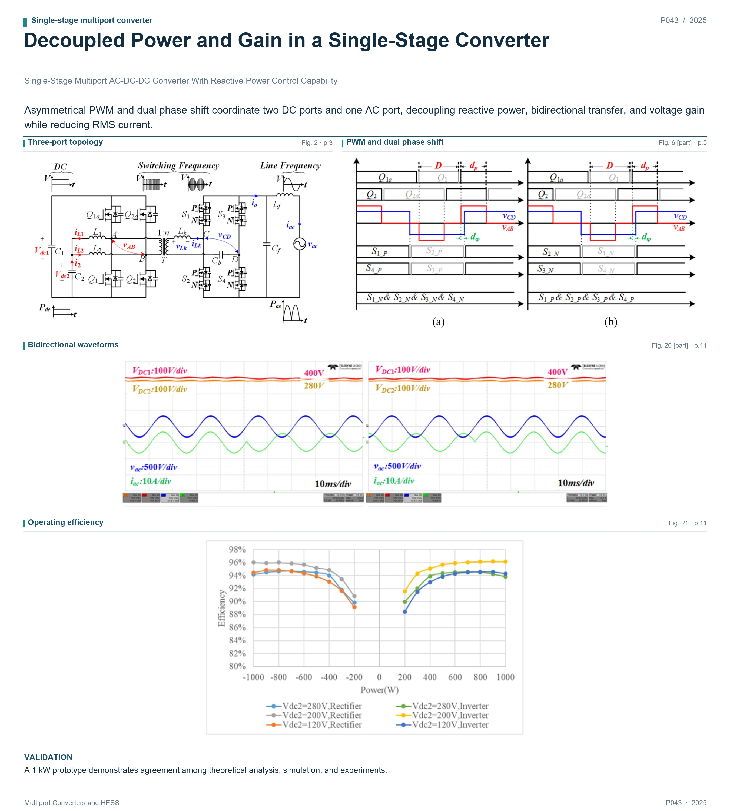

## Abstract

This article introduces a single-stage three-port ac–dc–dc converter designed to overcome the limitations observed in conventional two-stage converters used in grid-tied applications with multiple dc sources, such as hybrid energy storage systems and microgrids. Traditional two-stage converters, typically comprising a dc–dc converter followed by a dc–ac inverter, are hindered by the multiple power conversion stages, an excess of components, and an insufficient number of dc ports. To address these issues, a single-stage three-port ac–dc–dc converter is proposed in this article. This converter serves as an interface among two dc ports and one ac port. The employed asymmetric PWM combined with dual-phase-shift modulation allows for the decoupling of reactive power control, bidirectional power transfer, and voltage gain regulation. Optimization efforts have been made to minimize the root mean square value of the leakage inductor current. Validation was achieved through experiments on a 1-kW prototype.

<figure id="research-figure" class="publication-figure">
  
</figure>
