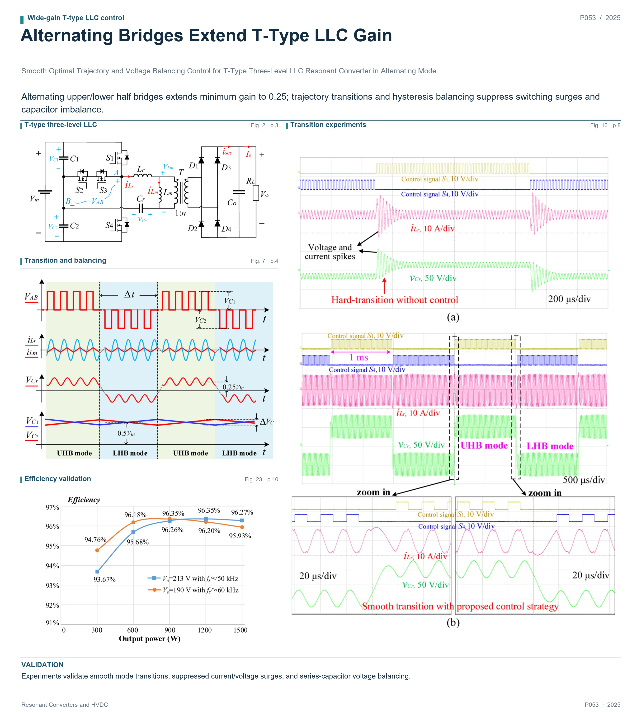

## Abstract

T-type three-level LLC converter combines the low conduction loss benefits of a two-level topology with the reduced switching voltage stress of a three-level topology. However, this converter has not received the attention it deserves because its voltage gain in previous studies has not been as wide as that of full-bridge and stacked half-bridge LLC converters. In this article, an alternating upper and lower half-bridge (AUL-HB) mode for T-type LLC converter is proposed to achieve a gain of 0.25. The AUL-HB mode presents challenges in mode switching and capacitor voltage balancing. To address these issues, a simple trajectory control method without extra sensors is developed to eliminate inrush currents and voltage surges during mode switching, ensuring smooth and fast transitions. Additionally, a hysteresis comparator-based voltage balancing control is proposed to maintain voltage balance across the series capacitors. Compared to previous studies, the proposed method achieves a gain of 0.25, which extends the traditional gain range reported in earlier literature, making the T-type LLC converter suitable for wide-gain applications. Experimental results validate the proposed smooth trajectory control with capacitor voltage balancing.

<figure id="research-figure" class="publication-figure">
  
</figure>
