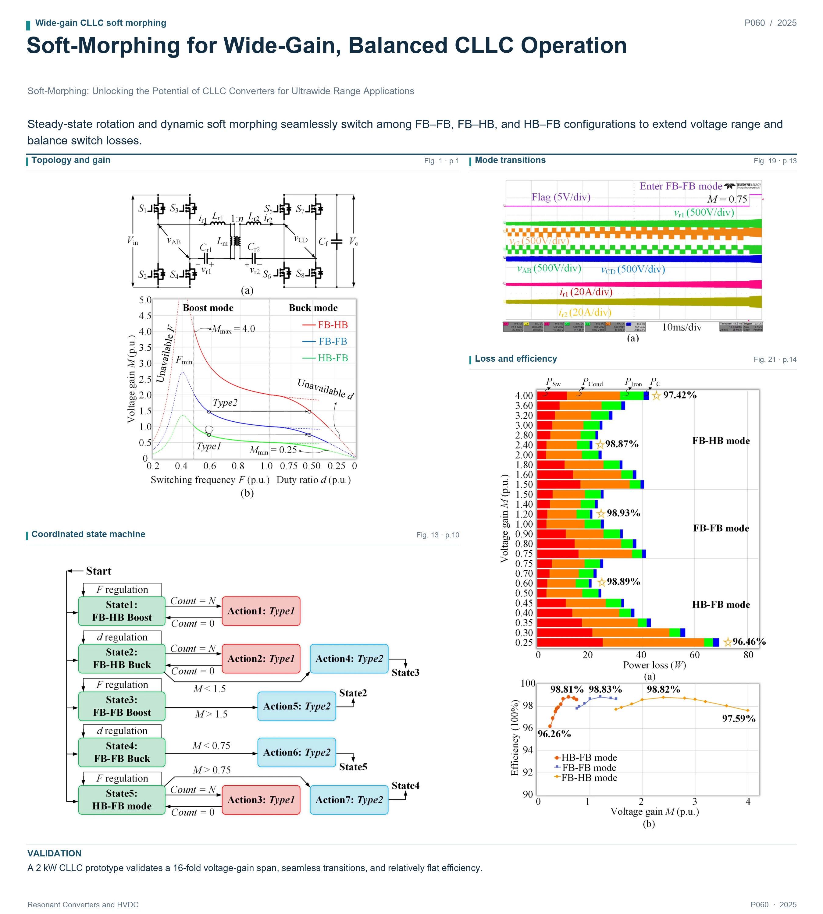

## Abstract

Expanding the voltage gain regulation range while preserving high efficiency of CLLC resonant converters is crucial yet challenging. Previous methods typically expanded the voltage gain range at the expense of a reduced efficiency. This article aims to unlock the full potential of CLLC resonant converters using full-bridge (FB) and half-bridge (HB) soft-morphing techniques. Two forms of soft-morphing are analyzed and developed: type1, steady-state rotational soft-morphing, which ensures balanced power loss and thermal stress across all power switches, and type2, dynamic soft-morphing, which facilitates smooth transitions between FB-FB, FB-HB, and HB-FB modes. Consequently, the full potential of the FB CLLC resonant converter is unlocked, achieving a 16× ultrawide voltage gain range. Building on this, a synergy control method is proposed and implemented on a 2-kW CLLC resonant converter prototype. Experimental results demonstrate that the proposed method facilitates seamless soft-morphing between different operation modes and maintains well-balanced power loss across different power switches. Furthermore, an ultraflat efficiency curve is achieved, indicating that the proposed method maintains high efficiency across various operating scenarios.

<figure id="research-figure" class="publication-figure">
  
</figure>
