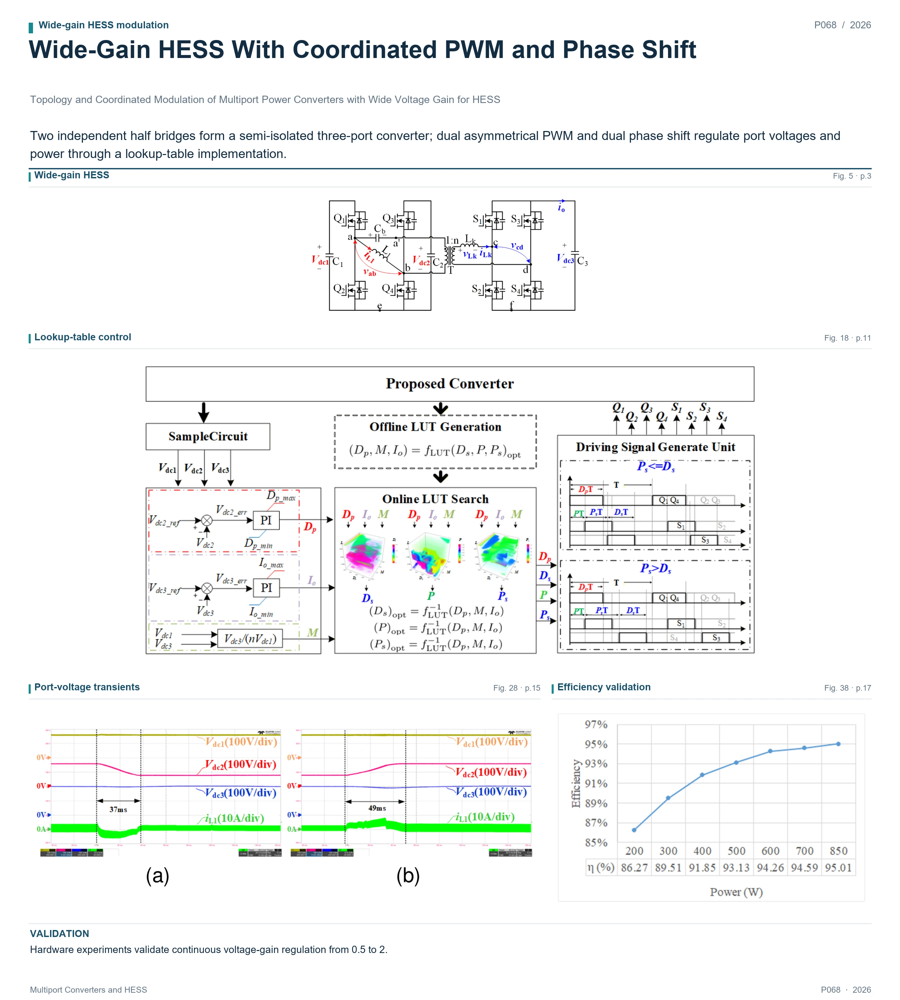

## Abstract

Hybrid energy storage systems (HESS), which combine high-energy-density storage (HES) and high-power-density storage (HPS), require power converters with wide voltage regulation capability due to the large voltage variation of storage devices. Existing HESS integration solutions either employ multiple converters with high component count or semi-isolated multiport converters with limited voltage-gain capability. This paper proposes a novel semi-isolated three-port DC–DC converter based on two independent half-bridge units. A coordinated dual asymmetric PWM and dual phase-shift modulation strategy is developed to achieve wide-range voltage regulation among HPS, HES, and application ports. The topology, modulation, and operating principles are analyzed, and an LUT-based implementation is developed for optimal operation. Experimental results obtained from a hardware prototype verify the effectiveness of the proposed converter in achieving voltage-gain regulation from 0.5 to 2 for HESS applications.

<figure id="research-figure" class="publication-figure">
  
</figure>
