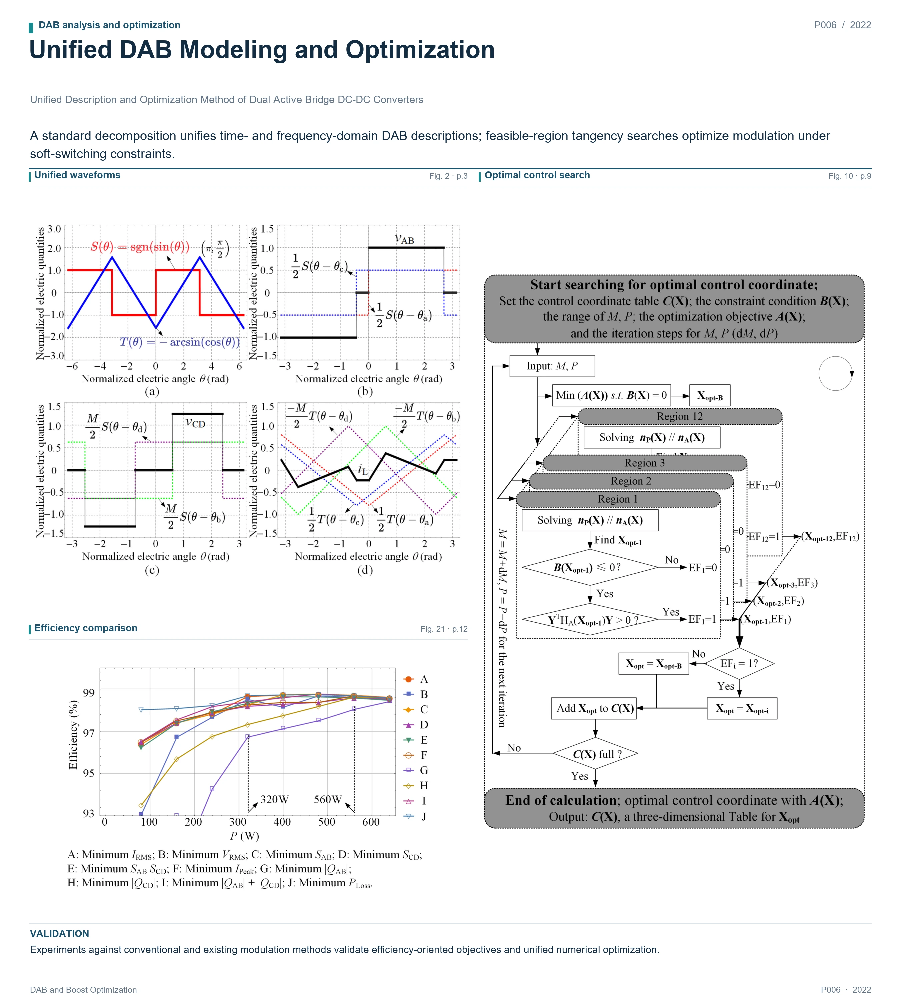

## Abstract

The optimization of dual active bridge converters (DAB) is widely studied and numerous modulation schemes are proposed to enhance the performance of a DAB converter. However, a unified description method both suitable for time and frequency domain analysis still lacks. Besides, the optimization process encounters a difficulty of the potential nonconvex feasible region restricted by the power transmission equality, making the regular convex optimization methods no longer applicable. To solve these problems, this article gave a unified description method both suitable for time and frequency domain analysis based on the standard decomposition of instantaneous electric quantities. Besides, a unified optimization method is proposed based on tangent point searching for the feasible region and optimization objective surfaces. With the proposed unified optimization method, the optimization objective can be designed arbitrarily as long as it is piecewise continuous, and smooth. An efficiency-oriented optimization objective design method is introduced considering all electric quantities as well as the soft-switching conditions. Finally, the experimental results confirm the unified optimization method and the efficiency-oriented optimization objective design method.

<figure id="research-figure" class="publication-figure">
  
</figure>
